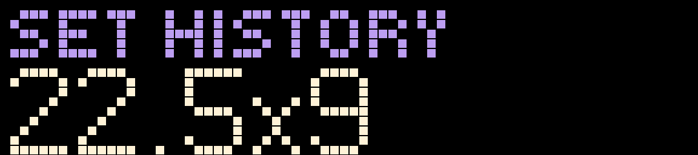
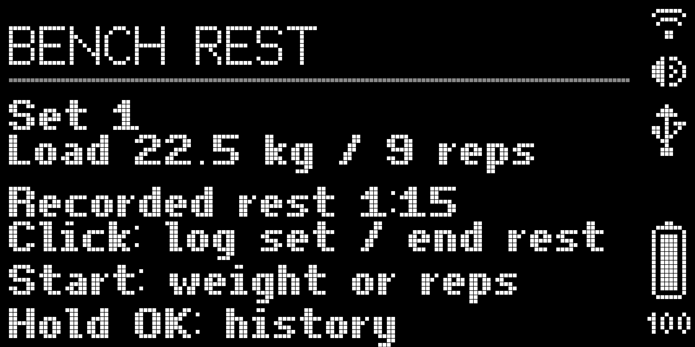
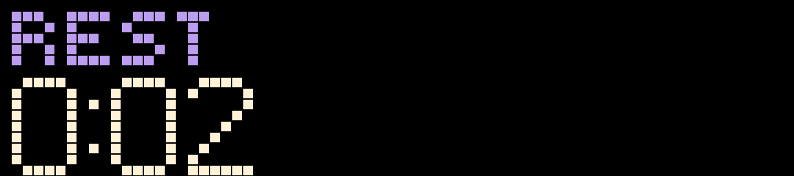

# Bench Rest

Log sets, working weight, repetitions and actual recovery time with desk controls.

Keep the set record and rest clock on one control. You can check what you lifted last time without guessing whether the recovery period was thirty seconds or two minutes.

## Screen transitions

Log the set, then return to its weight and rep count during the rest.



<details>

<summary>Watch the rear display</summary>



</details>

## Log a completed set

1. Turn the wheel to set your working weight in 2.5 kg increments. Press **Start** to switch to reps, then turn to the count you actually completed.
2. Click after the set. Bench Rest saves weight and reps together and starts the **Rest** timer.
3. The recording starts in set history and returns to a nine-rep setup before the rest clock opens.


## Review the last set

1. Click to end the rest when you are ready for the next set. The duration is attached to the set you just finished.
2. Hold the wheel for **Set history**. Turn to browse the last 20 entries. The rear shows the selected entry’s recorded rest.
3. Click to leave history. The clip shows the rest timer giving way to a stored 22.5 kg set of nine.



## Example from the emulator

If you log 22.5 kg for nine reps and end the rest at 1:15, that entry records those nine reps with 75 seconds of rest. The on-screen interval in the demonstration is short because the controls were pressed in quick succession.

## Run in the emulator

Open BUSY Bar Emulator. From this repository, run:

```sh
~/.busy-emulator/bin/busy-emulator dev --once
```

Press **Back** to exit.

The GIFs are excerpts from the emulator recording. Each LED occupies a 16 × 16 cell with a black border. The end frames pause for reading.

[Full recording](media/controls.mp4) · [Rear display](screenshots/back-1.png) · [Firmware test](EMULATOR-QA.md) · [MIT license](LICENSE)
